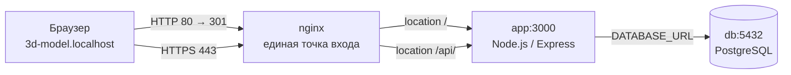

# Практические занятия 76-78 — Деплой приложения на выбранный хостинг 

Проект: **3D Models** — площадка для заказа 3D-моделей у фрилансеров (фулстек на Node.js + Express, база PostgreSQL).

## 1. Схема архитектуры



Все контейнеры находятся в одной сети Docker Compose. Снаружи доступен **только nginx**, и только на `127.0.0.1` (порты 80 и 443). Порты `app` и `db` наружу не публикуются.

## 2. Сервисы

| Сервис | Технология | Внутренний порт | Продакшен-сервер |
|---|---|---|---|
| nginx | nginx:1.27-alpine | 80, 443 | — (обратный прокси, HTTPS) |
| app | Node.js 20 + Express | 3000 | `node server/index.js`, `NODE_ENV=production` |
| db | PostgreSQL 16 | 5432 | — (образ postgres:16-alpine) |

## 3. Переменные окружения и секреты (только имена)

- `PORT` — порт приложения внутри контейнера.
- `NODE_ENV` — режим продакшена.
- `DATABASE_URL` — строка подключения к БД (в Compose собирается из переменных ниже).
- `POSTGRES_USER`, `POSTGRES_PASSWORD`, `POSTGRES_DB` — параметры БД (значения хранятся только в локальном `.env`).
- `DATABASE_SSL` — использование SSL для подключения к БД.
- `COOKIE_SECURE` — передача cookie только по HTTPS (в Compose `true`).
- `TRUST_PROXY` — доверие заголовкам `X-Forwarded-*` от nginx (в Compose `true`).

Секреты: закрытый ключ сертификата (`certs/3d-model.localhost-key.pem`) и пароль БД. Папка `certs/`, файлы `.env` и `.env.*` (кроме `.env.example`) исключены из репозитория через `.gitignore` и из образа через `.dockerignore`.

## 4. Команды запуска и остановки

```bash
# Запуск (сборка образов и старт всех сервисов)
docker compose up --build -d

# Проверка состояния
docker compose ps

# Журналы
docker compose logs app
docker compose logs nginx
docker compose logs db

# Остановка
docker compose down
```

Адрес проекта: **https://3d-model.localhost** (домен из зоны `*.localhost`, сертификат выпущен через `mkcert`, HTTP перенаправляется на HTTPS кодом 301).

### Результат проверки запуска

- `docker compose ps`: сервисы `db` (healthy), `app` (Up), `nginx` (Up); порты `127.0.0.1:80->80/tcp` и `127.0.0.1:443->443/tcp` — только у nginx.
- `https://3d-model.localhost/` — HTTP 200, предупреждений о сертификате нет.
- `http://3d-model.localhost/` — 301 Moved Permanently, `Location: https://3d-model.localhost/`.
- `https://3d-model.localhost/api/modelers` — 200, в заголовках ответа присутствует `X-Robots-Tag: noindex, nofollow`.

## 5. Скриншоты

Скриншоты сохраняются в папке `deploy/screenshots/`:

- `docker-compose-ps.png` — вывод `docker compose ps` (все сервисы в состоянии Up);
- `site-https.png` — страница по адресу `https://3d-model.localhost` (сертификат браузером доверен);
- `network-api.png` — вкладка Network с запросом к `/api/` и заголовком `X-Robots-Tag`;
- `containers-ports.png` — список контейнеров в Docker Desktop: порты открыты только у nginx;
- `github-actions.png` — успешное выполнение workflow GitHub Actions (дополнительное задание).

Все скриншоты добавлены после фактического запуска проекта.

Ссылка на репозиторий: https://github.com/nylio-hub/3d-model  
Успешный запуск workflow: https://github.com/nylio-hub/3d-model/actions/runs/45623017914

## 6. Ошибки и способы их устранения

- `mkcert` не был установлен → установлен командой `winget install --id FiloSottile.mkcert -e`, затем `mkcert -install` и выпуск сертификата для `3d-model.localhost`.
- Пароль БД был зашит прямо в `docker-compose.yml` → вынесен в `.env`, Compose подставляет значения через `${...}`; в `.env.example` оставлены только имена переменных.
- Контейнер запускался от `root` → в `Dockerfile` добавлены `RUN mkdir -p public/uploads && chown -R node:node /app` и `USER node`.
- `COOKIE_SECURE`/`TRUST_PROXY` были отключены → включены в `docker-compose.yml` для работы за nginx по HTTPS.
- В журнале nginx при старте видно сообщение `can not modify /etc/nginx/conf.d/default.conf (read-only file system?)` — это штатное поведение entrypoint'а: конфиг смонтирован с флагом `:ro`, nginx успешно стартует и отвечает по HTTPS (ошибкой не является).

## 7. Что нужно изменить, чтобы опубликовать проект на реальном сервере

1. Арендовать сервер/облачный хостинг и зарегистрировать реальный домен, создать A-запись на IP сервера.
2. Заменить локальный сертификат mkcert на сертификат публичного центра (Let's Encrypt + Certbot), заменить `server_name` и пути `ssl_certificate*` в `nginx/nginx.conf`.
3. Хранить реальные секреты не в `.env`, а в защищённом хранилище (секреты CI/CD, vault); обеспечить соблюдение 152-ФЗ (локальная БД и российские сервисы авторизации).
4. Настроить Continuous Delivery: доставку образа из GHCR на сервер и его запуск (например, через SSH и `docker compose pull && docker compose up -d`), при необходимости добавить мониторинг и алерты.
5. Публиковать только порты 80/443, оставив внутренние сервисы в сети Compose.

## 8. CI/CD

Workflow `.github/workflows/build.yml`:
- триггеры: `push`, `pull_request`, `workflow_dispatch` (ручной запуск);
- job `test` проверяет наличие основных файлов проекта;
- job `build` выполняет `docker build -t 3d-model:ci .` (проверка сборки образа) и при событиях `push`/`workflow_dispatch` публикует образ в GitHub Container Registry с тегами `latest` и хэша коммита.

CI (проверка сборки) является обязательной частью работы; публикация и доставка образа на сервер (CD) — дополнительное задание.
